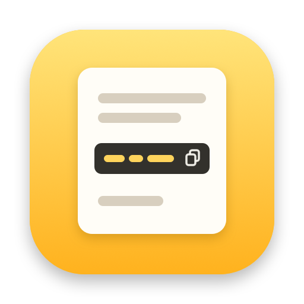
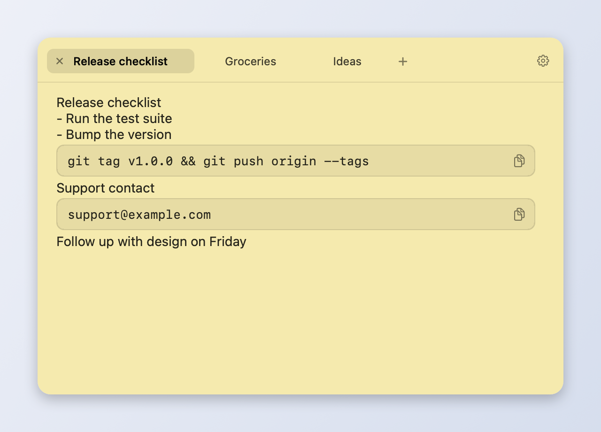

<p align="center">
  
</p>

<h1 align="center">Quotepad</h1>

<p align="center">
  A Spotlight-style scratchpad for macOS. Press <kbd>⌘</kbd> <kbd>'</kbd> anywhere, jot it down, and get back to work.
</p>

<p align="center">
  
  
  
  
</p>

<p align="center">
  
</p>

## Why

Some notes don't deserve a Notes.app document: an email address you're about to paste, a command you'll run three times today, a phone number from a call. Quotepad is a single floating panel that appears over whatever you're doing and disappears when you're done. No windows to manage, no Dock icon, no sync, no accounts.

## Features

- **Global hotkey.** <kbd>⌘</kbd> <kbd>'</kbd> toggles the panel from any app, on any Space, even over full-screen apps.
- **Tabs.** Keep several notes side by side. Tab titles come from each note's first line.
- **Copyable boxes.** Type `/p` and press <kbd>Return</kbd> for a one-line box for emails, API keys and shell commands, or `/code` for a multi-line code block that keeps indentation. Boxes scroll horizontally and have a one-click copy button. Smart quotes and autocorrect are off inside boxes, so what you copy is exactly what you typed.
- **Survives crashes and power loss.** Notes are saved 1 second after you stop typing (at most 5 seconds during non-stop typing) using `F_FULLFSYNC` and an atomic rename, and are flushed on quit, sleep and shutdown.
- **Make it yours.** Light/dark theme, seven background tints (sticky-note yellow included), background opacity, font size, and system, monospaced or serif fonts.
- **Stays out of the way.** Lives in the menu bar, hides when you click elsewhere (optional), remembers its size and, optionally, its position.
- **Plain text on disk.** Everything lives in one JSON file. Code boxes are stored as Markdown fences, so your notes are readable without the app.
- **Tiny.** One Swift package with AppKit and nothing else.

## Install

Requires macOS 13 or later.

### Download

1. Download `Quotepad-<version>.dmg` from [Releases](https://github.com/Ohjackson/Quotepad/releases).
2. Open it and drag **Quotepad** onto **Applications**.
3. Quotepad isn't notarized by Apple yet, so the first launch is blocked. Open it once, then go to **System Settings → Privacy & Security** and click **Open Anyway**. You only need to do this once.

Look for the note icon in the menu bar, then press <kbd>⌘</kbd> <kbd>'</kbd>.

### Build from source

You need the Xcode Command Line Tools (`xcode-select --install`).

```bash
git clone https://github.com/Ohjackson/Quotepad.git
cd Quotepad
./scripts/build-app.sh --install   # builds and installs to /Applications
./scripts/make-dmg.sh              # or: builds build.noindex/Quotepad-<version>.dmg
```

To start Quotepad at login, open the gear menu in the panel (or the menu bar icon) and turn on **Launch at login**.

## Usage

| Shortcut | Action |
| --- | --- |
| <kbd>⌘</kbd> <kbd>'</kbd> | Show / hide the panel (works everywhere) |
| <kbd>⌘</kbd> <kbd>T</kbd> | New tab |
| <kbd>⌘</kbd> <kbd>W</kbd> | Close tab (hides the panel on the last tab) |
| <kbd>⌘</kbd> <kbd>⇧</kbd> <kbd>[</kbd> / <kbd>⌘</kbd> <kbd>⇧</kbd> <kbd>]</kbd> | Previous / next tab |
| <kbd>⌃</kbd> <kbd>Tab</kbd> / <kbd>⌃</kbd> <kbd>⇧</kbd> <kbd>Tab</kbd> | Next / previous tab |
| <kbd>⌘</kbd> <kbd>,</kbd> | Settings |
| <kbd>Esc</kbd> | Hide the panel |
| `/p` <kbd>Return</kbd> | Insert a one-line copy box |
| `/code` <kbd>Return</kbd> | Insert a multi-line code block |

Standard editing shortcuts (<kbd>⌘</kbd> <kbd>C</kbd>/<kbd>X</kbd>/<kbd>V</kbd>/<kbd>A</kbd>/<kbd>Z</kbd>, <kbd>⌘</kbd> <kbd>⇧</kbd> <kbd>Z</kbd>) work as usual. Shortcuts are matched by key position, so they keep working with non-Latin input sources such as Korean.

Inside a one-line box, <kbd>Return</kbd> or <kbd>↓</kbd> moves to the line below, <kbd>↑</kbd> moves above, and <kbd>Delete</kbd> in an empty box removes it. In a code block, <kbd>Return</kbd> starts a new line with the same indentation, <kbd>Tab</kbd> indents, and <kbd>↑</kbd> on the first line or <kbd>↓</kbd> on the last line leaves the block. Copying a selection that contains boxes puts Markdown fences on the clipboard (```` ``` ```` for one-line boxes, `~~~` for code blocks), and pasting fenced text creates boxes.

Tabs close for good: there's no trash. Click the **×** on a tab, middle-click it, or press <kbd>⌘</kbd> <kbd>W</kbd>.

> [!NOTE]
> The interface is currently in Korean. Localization pull requests are very welcome.

## Where your notes live

```
~/Library/Application Support/Quotepad/tabs.json
```

Settings are stored in `UserDefaults` under `dev.micheal.Quotepad`. **Settings → Open data folder** reveals the file in Finder. If the file is ever unreadable, Quotepad moves it aside as `tabs.corrupt-<timestamp>.json` instead of overwriting it.

## Development

```bash
swift build -c release
QUOTEPAD_DATA_DIR=/tmp/quotepad-dev ./.build/release/Quotepad
```

`QUOTEPAD_DATA_DIR` points a development build at a separate folder so it can run next to your installed copy without touching your real notes. Only one instance can use a given data folder at a time.

| Path | Purpose |
| --- | --- |
| `Sources/Quotepad/AppDelegate.swift` | Panel, tabs, shortcuts, saving, global hotkey |
| `Sources/Quotepad/CodeBlock.swift` | One-line boxes and code blocks (TextKit 2 view attachments) and the note ⇄ Markdown codec |
| `Sources/Quotepad/Markdown.swift` | Live Markdown styling, hidden syntax marks, list continuation |
| `Sources/Quotepad/TabBarView.swift` | Tab strip UI |
| `Sources/Quotepad/DurableStore.swift` | Crash-safe file writes |
| `Sources/Quotepad/Settings.swift` | Preferences, background tints, login item |
| `Sources/Quotepad/SettingsViewController.swift` | Settings popover |
| `scripts/build-app.sh` | Builds the `.app` bundle; `--install` copies it to `/Applications` |
| `scripts/make-dmg.sh` | Builds a drag-to-install `.dmg` for releases |
| `scripts/make-icon.swift` | Regenerates `Resources/AppIcon.icns` and `docs/icon.png` |

## Contributing

Issues and pull requests are welcome. See [CONTRIBUTING.md](CONTRIBUTING.md) for how to build, test safely, and send a change.

## License

[MIT](LICENSE) © Jaehyun Ahn
